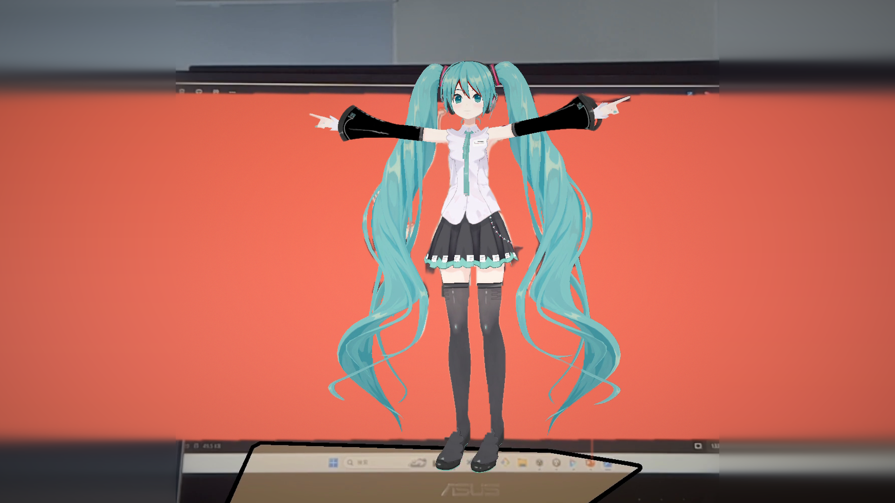

# AR 初音ミク ダンス

スマートフォンのカメラ越しに、現実の床の上で初音ミクが「ダンスロボットダンス」を踊る AR アプリです。
NAIST スプリングセミナー 2025 で制作しました。

🎬 デモ動画：https://youtu.be/XVdnpx9j8sA?si=137gI_zKpeDP3Oyi

## 主な機能

- **床の検出**：AR Foundation の平面検出で、カメラに映った床を認識します
- **タップで配置**：検出した床をタップすると、その位置にミクが現れます（`Assets/Placement_withAudio (1).cs`）
- **ダンス**：配置されたミクが、MMD 用のダンスモーションに合わせて踊ります

## 使用技術

| 分類 | 内容 |
|---|---|
| エンジン | Unity 6.3 LTS（6000.3.10f1）、Universal Render Pipeline 17.3 |
| AR | AR Foundation 6.3.5、Google ARCore XR Plugin 6.3.5 |
| その他パッケージ | XR Interaction Toolkit 3.3.2、Input System 1.18 |
| モーション変換 | Blender 5.2 + MMD Tools（`.vmd` → FBX） |
| 言語 | C# |
| 対応端末 | Android（ARCore 対応端末） |

### モーションの変換の流れ

MMD 用のモーション（`.vmd`）は Unity でそのまま再生できないため、次の手順で変換しています。

1. Blender + MMD Tools で、標準的な骨格の MMD モデルにモーションを読み込む
2. IK などの動きをベイクして、FBX として書き出す
3. Unity で FBX を Humanoid に設定し、アニメーションを別のモデル（止丸式初音ミクNT）に当てはめる

## リポジトリに含まれていない素材

規約により再配布できない素材は、このリポジトリに含めていません（`.gitignore` で除外しています）。
プロジェクトを動かすには、以下を各自で入手して配置してください。

| 素材 | 作者・配布元 | 配置する場所 |
|---|---|---|
| 3Dモデル「止丸式初音ミクNT」 | 止丸 様 / [BOOTH](https://booth.pm/ja/items/3226395) | `Assets/〇止丸式初音ミクNT_ver1.1.2/` |
| モーション「ダンスロボットダンス」 | ねこがし 様 / [ニコニコ動画](https://www.nicovideo.jp/watch/sm35666874)（配布先：[BowlRoll](https://bowlroll.net/file/206924)） | `Assets/Animation/Animation/DanceRobotDance/` |
| 3Dモデル「とっと式初音ミクV3」（モーション変換用） | とっと 様 | 任意（Blender での変換にのみ使用） |
| 楽曲「ダンスロボットダンス」 | ナユタン星人 様 / [楽曲使用ガイドライン](https://nayutalien.com/guideline/) | 任意 |

モーションは、上の「モーションの変換の流れ」の手順で FBX に変換してから `DanceRobotDance/` に置き、
`Assets/Miku_Dance_Controller.controller` のステートに割り当ててください。

## クレジット

- 楽曲：ダンスロボットダンス / ナユタン星人 様 https://www.nicovideo.jp/watch/sm30177801
- 振付：ぽるし 様 https://www.nicovideo.jp/watch/sm30893876
- モーション：ねこがし 様 https://www.nicovideo.jp/watch/sm35666874
- モデル：止丸式初音ミクNT / 止丸 様 https://booth.pm/ja/items/3226395
- AR のサンプル：[Unity AR Foundation Samples](https://github.com/Unity-Technologies/arfoundation-samples)（`Assets/Scenes/` 以下）

初音ミクは、クリプトン・フューチャー・メディア株式会社の著作物です。
本作品は [ピアプロ・キャラクター・ライセンス](https://piapro.jp/license/pcl/summary) に基づいて制作しています。
© Crypton Future Media, INC. www.piapro.net

## 今後やりたいこと

- [ ] 表情（`Dance_Face.vmd`）の反映
- [ ] 楽曲との同期再生

## ライセンス

このリポジトリに含まれる自作のスクリプトや設定ファイルは、自由に参考にしていただいて構いません。
`Assets/Scenes/` 以下の AR Foundation のサンプルは、Unity Technologies のライセンスに従います。
上記「リポジトリに含まれていない素材」は、それぞれの作者の利用規約に従ってご利用ください。
